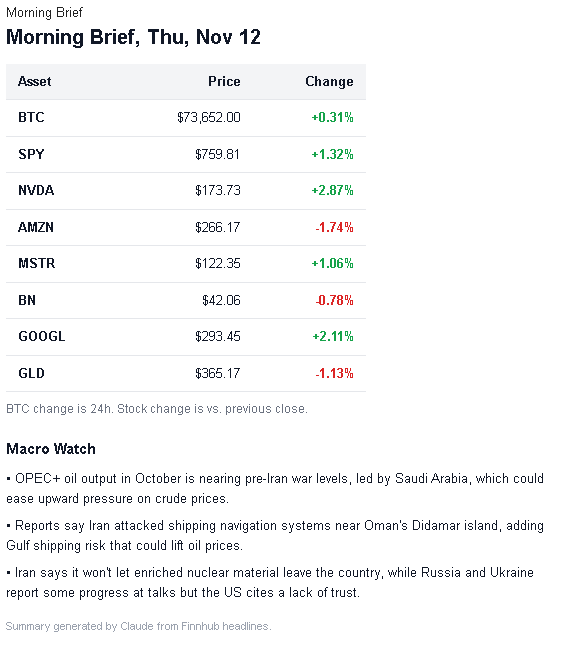
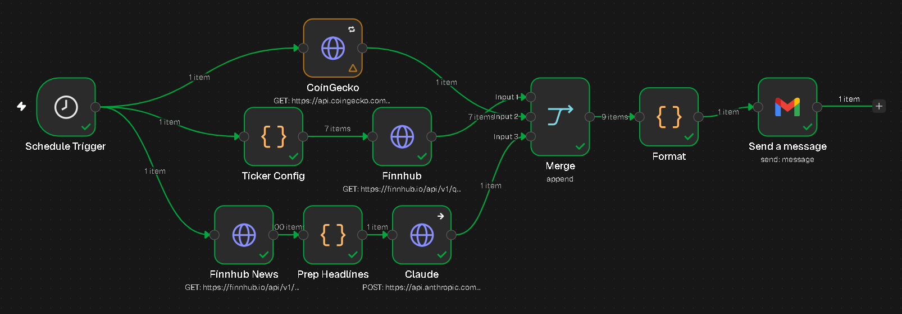

# Morning Brief: Automated Market Briefing with n8n + Claude

A self-hosted n8n workflow that emails me a market brief every weekday at 7 am: live prices for Bitcoin and my stock holdings in a color-coded table, plus a three-bullet macro summary written by Claude from the last 24 hours of financial news.
_________________________________________________________________________________________________________________________________________________________________________________________________________________



_________________________________________________________________________________________________________________________________________________________________________________________________________________
## What it does

Every weekday morning the workflow:

1. Pulls the BTC price and 24-hour change from **CoinGecko**
2. Pulls live quotes for a configurable list of tickers (SPY, NVDA, AMZN, MSTR, BN, BMNR, GLD) from **Finnhub**
3. Pulls the latest general market news from **Finnhub**, filters it to macro topics (Fed/rates, jobs, inflation, oil, policy), and sends the headlines to the **Claude API** for a three-bullet summary
4. Merges all three sources into one HTML email and sends it through **Gmail**

## Architecture


```
                ┌→ CoinGecko ──────────────────────────────────────┐
Schedule Trigger┼→ Ticker Config → Finnhub (quotes) ───────────────┼→ Merge → Format → Gmail
                └→ Finnhub News → Prep Headlines → Claude ─────────┘
```

| Node | Type | Role |
|---|---|---|
| Schedule Trigger | Trigger | Fires at 7:00 am, Monday to Friday |
| CoinGecko | HTTP Request | BTC price and 24h % change |
| Ticker Config | Code | One place to edit the watchlist; outputs one item per ticker |
| Finnhub | HTTP Request | Runs once per ticker against the `/quote` endpoint |
| Finnhub News | HTTP Request | General market news from the `/news` endpoint |
| Prep Headlines | Code | Keeps the last 24 hours, filters to macro keywords, formats up to 20 headlines |
| Claude | HTTP Request | Claude Haiku summarizes the headlines into 3 bullets |
| Merge | Merge (Append) | Waits for all three branches to finish |
| Format | Code | Builds the HTML table and macro section |
| Gmail | Gmail | Sends the brief |

## Design decisions

**The watchlist lives in its own node.** Finnhub's quote endpoint takes one symbol per call. Instead of hard-coding several HTTP nodes, a Ticker Config node outputs one item per ticker, and n8n runs the HTTP node once per item. Adding a ticker is a one-word edit.

**Data is read by node name, not by position.** The first version of the formatter read `$input.first()`, which broke as soon as a Merge node changed the item order. The formatter now pulls each source directly (`$('CoinGecko')`, `$('Finnhub')`, `$('Claude')`), so adding a new branch doesn't break existing logic.

**Claude's response is parsed by block type.** Newer Claude models can return a thinking block before the answer, so `content[0].text` is not reliably the answer. The formatter filters `content` for blocks where `type === 'text'`.

**Token cost is kept low on purpose.** Summarizing 20 headlines is a simple task, so the request sets `output_config.effort` to `low` to cut down on extended thinking. `max_tokens` is a safety ceiling covering thinking and answer together, not a target. Per-run usage is checked in the response's `usage` field.

**It degrades instead of failing.** API nodes use Retry On Fail (3 tries, 5-second wait) to handle transient network and DNS errors. The Claude node continues on error, and the formatter falls back to "Macro headlines unavailable today" so the price table still arrives. Tickers that Finnhub doesn't cover show "no data" instead of breaking the layout.

**Email HTML uses inline styles only.** Gmail strips `<style>` blocks and classes, so every color and border is set inline.

## Tech stack

- **n8n** (self-hosted in Docker Desktop)
- **CoinGecko API** (free, no key)
- **Finnhub API** (free tier: `/quote` and `/news`)
- **Claude API** (`claude-haiku-5-5`)
- **Gmail** via Google OAuth
- **JavaScript** in n8n Code nodes

## Setup

1. Run n8n locally with Docker
2. Import `workflow.json` (**Workflows → Import from File**)
3. Create these credentials in n8n:
   - **Finnhub:** Header Auth, name `X-Finnhub-Token`, value = your Finnhub API key
   - **Anthropic API:** Header Auth, name `x-api-key`, value = your Claude API key
   - **Gmail:** Google OAuth2 (redirect URI `http://localhost:5678/rest/oauth2-credential/callback`, Gmail API enabled in Google Cloud)
4. Attach the credentials to the matching nodes, set your email address in the Gmail node, and edit the ticker list in **Ticker Config**
5. Activate the workflow

## Limitations

- It runs on a local machine, so the laptop has to be awake with Docker running at 7 am.
- Stock % change is measured against the previous close. Before the open, it reflects the prior session.
- Finnhub's free news feed is general, so the macro filter is keyword-based and can miss stories or let noise through.

## Roadmap

- [ ] Move to a small cloud server so it runs without the laptop
- [ ] Weekend crypto-only version
- [ ] Earnings-date alerts for holdings
- [ ] Add oil, Treasury yields, and key macro releases (CPI, jobs report) to the table
